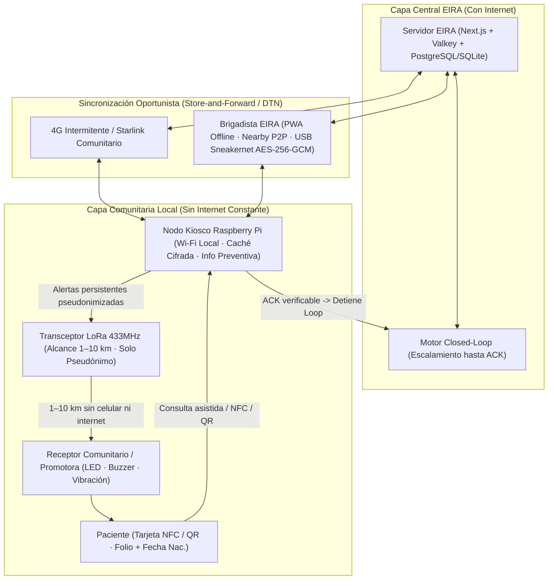
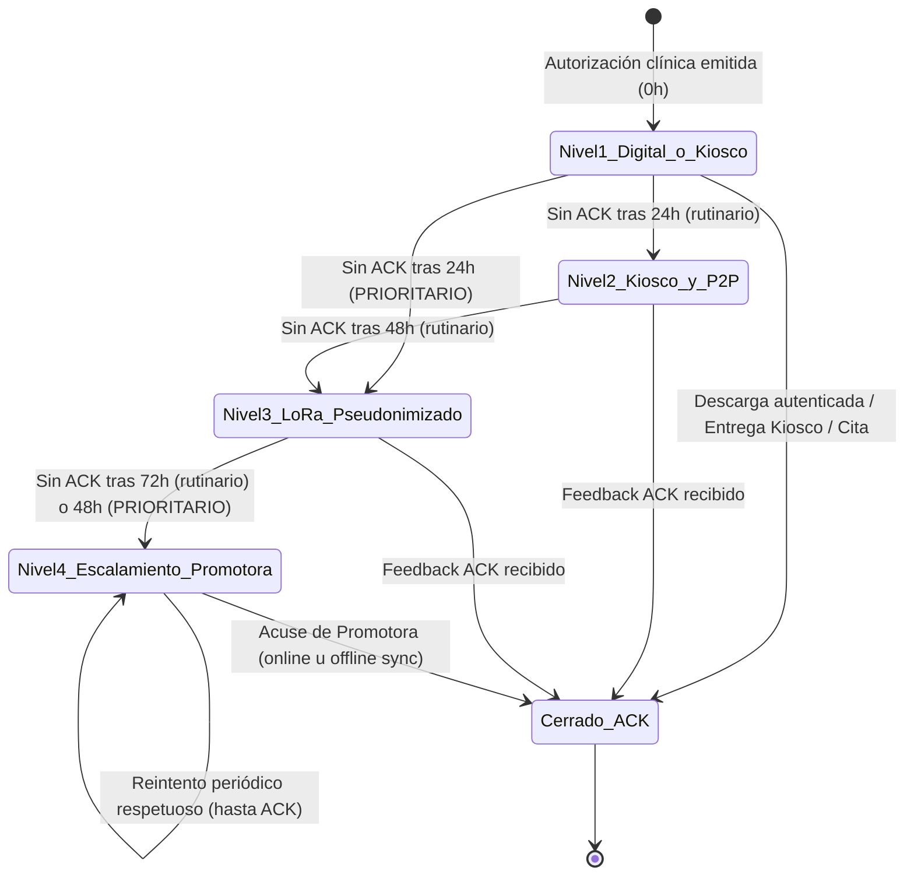

# Documentación Técnica: NFC, Red Híbrida Offline, Bridgefy/Nearby/LoRa y Motor Closed-Loop — EIRA Resultados Seguros

Este documento detalla la arquitectura de **conectividad sin internet, identificación física sin fricción (NFC/QR) y ciclo cerrado de alertas persistentes (*Closed-Loop*)** diseñada para **EIRA Movimiento Rosa A.C.** en el **Vibeathon Nerdearla México 2026 (Reto 4)**.

---

## 1. Transparencia de Alcance: Implementado Hoy vs. Simulado / Piloto Real

| Componente | Estado en el Prototipo de Hoy | Qué cambia en Piloto Real con EIRA |
| --- | --- | --- |
| **Motor Closed-Loop de alertas insistentes** (`src/lib/loop-engine.ts`) | **Implementado 100%** (niveles 1–4, reglas por prioridad, avance `+24h/+48h` y parada automática al recibir ACK) | Cron/worker persistente (Valkey + worker en contenedor/AWS) con ventanas horarias laborales (9:00–18:00 h). |
| **Guardia de privacidad sin diagnósticos** (`assertNoClinicalLeak`) | **Implementado 100%** en todas las notificaciones y paquetes | Se mantiene idéntico + auditoría periódica de plantillas. |
| **Empaquetado offline cifrado *Store-and-Forward*** (`src/lib/crypto-pack.ts`) | **Implementado 100%** (`AES-256-GCM` + `SHA-256` + cola `localStorage` + `synced_from_offline: true`) | Persistencia en SQLite cifrado local en Raspberry Pi + sincronización automática 4G/Starlink o *Sneakernet* USB. |
| **Tarjeta "Semáforo Clínico" QR + Escáner cámara/PC** (`qrcode` + `jsQR`) | **Implementado 100%** (generación, descarga PNG, impresión y escaneo en vivo online/offline) | Impresión térmica en jornada y grabación opcional del mismo payload JSON en etiquetas **NFC pasivas NTAG213/215**. |
| **Kiosco Comunitario Raspberry Pi** (`/kiosco`) | **Implementado en software (PWA Local-First)** / Hardware RPi simulado | Despliegue en Raspberry Pi 4/5 con `hostapd` (Hotspot Wi-Fi local), pantalla táctil 7" y lector USB QR/NFC. |
| **Capas de transporte sin señal (LoRa 433 MHz / Nearby P2P / Bridgefy)** | **Simulado verificable** (generación de payloads pseudonimizados y eventos por capa en `/alertas-loop`) | Transceptor físico **LoRa SX1278 (433 MHz)** conectado al Raspberry Pi + app brigadista (Tauri 2/Rust con Web NFC/Nearby). |

---

## 2. Identificación Física Sin Fricción: NFC Pasivo + Respaldo QR ("Semáforo Clínico")

### ¿Por qué NFC + QR en comunidades alejadas?
Muchas pacientes no tienen correo electrónico, smartphone propio ni familiaridad con contraseñas. El objetivo es ofrecer un **identificador físico duradero, reutilizable y privado** que funcione tanto en el **Kiosco Comunitario Raspberry Pi** como con una **promotora de salud en campo**.

### Especificación técnica
- **Chips NFC recomendados:** Etiquetas pasivas estándar **NTAG213 / NTAG215 / NTAG216** (ISO 14443-A, sin batería, costo unitario ~$0.30–$0.80 USD en pulsera o tarjeta plástica).
- **Respaldo universal (implementado hoy):** La misma tarjeta incluye un **código QR impreso** (y folio legible) para garantizar compatibilidad con cualquier cámara de celular, webcam o lector óptico básico incluso si el dispositivo no tiene antena NFC.
- **Payload almacenado (Cero PII sensible y Cero Diagnósticos):**
  ```json
  {
    "v": 1,
    "folio": "PAC-2026-005",
    "pseudo": "EIRA-ALR-4104",
    "mode": "acompanado",
    "portal": "/kiosco"
  }
  ```
  - Si la tarjeta se extravía, **nadie puede conocer el diagnóstico médico** ni descargar el PDF sin pasar por la verificación de identidad (fecha de nacimiento + PIN impreso o validación física con la promotora).

### Funcionamiento del "Semáforo Clínico" (al acercar NFC o escanear QR)
| Color | Significado operativo para Kiosco / Promotora | Acción esperada |
| --- | --- | --- |
| **Verde** | Resultado rutinario autorizado y disponible | Validar fecha de nacimiento/PIN y entregar en sobre cerrado o consulta segura. |
| **Rojo (Prioritario)** | Resultado autorizado en modalidad **Entrega Acompañada** | Bloquea descarga desatendida; coordina orientación médica cálida y prioritaria con EIRA. |
| **Ámbar** | Estudio aún en revisión administrativa o clínica | Informar que está en proceso; sin acciones pendientes de la paciente. |
| **Gris** | Resultado entregado / consultado con **ACK registrado** | Ciclo cerrado; el motor de alertas se encuentra detenido. |

### Alertas físicas de corto alcance con NFC
Como un chip NFC es pasivo (sin batería), su alcance es de **2 a 4 cm** y sirve para **identificación y confirmación presencial**:
1. **Con celular de la promotora:** Al acercar la tarjeta, la app/PWA lee el pseudónimo contra su caché offline y dispara vibración o señal visual de semáforo (sin internet).
2. **Con lector USB en el Kiosco Raspberry Pi:** Lectura instantánea de tarjeta para pacientes con bajas habilidades digitales.
3. **Etiqueta NFC con micro-LED pasivo (opcional):** Se ilumina al recibir energía del campo electromagnético del lector para confirmar visualmente la lectura correcta.

---

## 3. Arquitectura de Red Híbrida para Comunidades Sin Señal Constante

En localidades rurales dispersas, **ninguna tecnología inalámbrica única resuelve todos los escenarios**. Por ello proponemos una **arquitectura híbrida en 4 capas** donde cada tecnología cubre exactamente el rango donde es confiable y sostenible.



### Análisis comparativo: Bridgefy vs. Nearby Connections vs. Wi-Fi Local RPi vs. LoRa

| Tecnología | Medio y alcance real | ¿Requiere internet? | ¿Requiere celular en la paciente? | Licencia / Sostenibilidad EIRA | Rol exacto en nuestra arquitectura |
| --- | --- | --- | --- | --- | --- |
| **Bridgefy (BLE Mesh)** | Bluetooth Low Energy en malla (~30–100 m por salto). | **No** | **Sí** (y alta densidad de equipos cercanos con la app activa). | **Propietario / SDK de pago** en producción (riesgo para ONG). | **Referencia evaluada y no recomendada como dependencia principal** por licencia comercial y baja densidad de smartphones en rancherías dispersas; solo útil en eventos masivos con muchos celulares cercanos. |
| **Google Nearby Connections (Android) / Apple Multipeer (iOS)** | BLE + Wi-Fi Direct P2P (~30–100 m sin router). | **No** | Solo en dispositivos del personal/brigadistas. | **Gratuito** (APIs nativas de SO), pero **Android e iOS no interoperan directamente entre sí**. | **Capa 2 (Sincronización P2P entre brigadistas y nodos):** intercambio rápido de paquetes cifrados *Store-and-Forward* en campo sin red celular. |
| **Hotspot Wi-Fi Local en Raspberry Pi** | Wi-Fi 2.4/5 GHz local (~30–80 m alrededor del kiosco). | **No** (red LAN cautiva `EIRA-Kiosco`). | **No obligatorio** (el kiosco tiene pantalla táctil; quien sí trae celular entra por navegador sin saldo ni app). | **100% Open Source** (Linux + `hostapd` + PWA). | **Nodo comunitario universal (puente Android/iOS/PC):** entrega asistida, verificación QR/NFC, caché cifrada `AES-256-GCM` y educación preventiva offline. |
| **LoRa 433 MHz (`SX1278` / ESP32 / Meshtastic)** | Radiofrecuencia sub-GHz de espectro ensanchado (**1 a 10 km** en terreno rural, atraviesa muros). | **No** | **No** (receptor dedicado de bajo consumo con batería/panel solar). | **100% Open Source** y hardware económico (~$20–$30 USD por nodo). | **Capa 3 (Alertas a distancia sin señal):** transmite pings periódicos **exclusivamente pseudonimizados** desde el Kiosco RPi hacia el módulo de la promotora o punto comunitario. |
| **SMS / Correo Neutro (Twilio / SES / Resend)** | Red celular 2G/3G/4G o internet convencional. | Parcial (SMS funciona en 2G sin datos). | Sí (teléfono básico o correo). | Pago mínimo por volumen (~$0.01–$0.04 USD/SMS). | **Capa 1 (Con señal):** primera línea de aviso neutro sin diagnósticos cuando la paciente tiene cobertura. |

### Seguridad en la sincronización *Store-and-Forward* (Raspberry Pi y Brigadistas)
- **Aislamiento por comunidad:** El endpoint `/api/kiosk/sync?kiosk_id=KIOSK-SIERRA-01` **solo** empaqueta los estudios clínicamente autorizados pertenecientes a esa comunidad/nodo.
- **Cifrado autenticado en tránsito y reposo:** Cada paquete se cifra con **AES-256-GCM** (`iv_hex`, `auth_tag_hex`, `ciphertext_b64`) más huella de integridad **SHA-256** (`src/lib/crypto-pack.ts`).
- **Sincronización de subida (Uplink ACK):** Cuando la promotora registra una entrega sin señal, el acuse se guarda en cola local (`localStorage` / SQLite local en RPi) y al recuperar conexión (o llegar a zona con señal) se sube automáticamente con `synced_from_offline: true`, cerrando el loop en el servidor central.

---

## 4. Motor Closed-Loop: Alertas Insistentes con Parada Verificable (ACK)

El mayor riesgo clínico en programas de detección oportuna de cáncer cervicouterino es la **pérdida de seguimiento**: la paciente se realiza la toma, el laboratorio detecta un hallazgo, pero el resultado nunca se entrega.

### Máquina de escalamiento progresivo (Implementada en `src/lib/loop-engine.ts`)



### Reglas éticas, de privacidad y de parada del Loop
1. **Insistente, pero respetuoso y confidencial:**
   - En canales abiertos/comunitarios (Kiosco Wi-Fi, Nearby P2P, LoRa 433 MHz), **jamás viajan el nombre completo ni el diagnóstico**. El paquete real emitido es:
     ```json
     {
       "pseudonym_code": "EIRA-ALR-4104",
       "kiosk_id": "KIOSK-SIERRA-01",
       "priority_flag": true,
       "action": "ACUDIR_MODULO_EIRA"
     }
     ```
   - En producción, los reintentos respetan horarios laborales (9:00–18:00 h) y cadencia controlada (anti-spam/anti-estigma).
2. **Aceleración diferenciada por prioridad clínica:**
   - **Rutinario:** escala a LoRa a las **48 h** y a Promotora a las **72 h**.
   - **Prioritario (entrega acompañada):** escala directamente a LoRa a las **24 h** y a Promotora a las **48 h**, bloqueando además la descarga desatendida (`HTTP 403`) para asegurar acompañamiento humano.
3. **Condición única de parada (*Stop Condition*):**
   - El loop **únicamente cambia a `cerrado_ack`** (y deja de emitir intentos, verificado en pruebas automatizadas) cuando se registra alguno de estos tres eventos auditables:
     1. **Descarga autenticada de la paciente** (con OTP en Valkey/TTL o PIN impreso de 4 dígitos y token efímero de 60 s).
     2. **Entrega asistida en Kiosco Raspberry Pi o por Brigadista Offline** (con folio de acuse `ACK-...` sincronizado).
     3. **Confirmación de cita de orientación médica acompañada**.

---

## 5. Costos Estimados de Piloto Comunitario, Riesgos y Preguntas Abiertas para EIRA

### Costo estimado por Nodo Comunitario (Hardware abierto, 1 sola vez)
| Concepto | Referencia | Costo aprox. (USD) |
| --- | --- | --- |
| Mini-computadora Edge | Raspberry Pi 4/5 (4 GB) + MicroSD industrial + gabinete/fuente | $75 – $95 |
| Lector físico sin fricción | Lector USB QR + Lector NFC USB (ACR122U o equivalente) | $25 – $40 |
| Enlace de alertas sin señal | Par de módulos ESP32 + LoRa 433 MHz (`SX1278`) con antena | $30 – $45 |
| Tarjetas/pulseras comunitarias | 300 etiquetas NFC NTAG213 o tarjetas QR laminadas | $40 – $90 |
| **Total estimado por comunidad** | **Infraestructura reutilizable sin licencias propietarias** | **~$170 – $270 USD** |

*Costos recurrentes en nube (300–1,000 resultados/mes):* instancia ligera + PostgreSQL + Valkey + S3 privado + SMS transaccional neutro ≈ **$25 – $60 USD/mes** (muy por debajo del costo operativo y humano de bloqueos de WhatsApp y pérdidas de seguimiento).

### Riesgos y mitigaciones
- **Pérdida o robo físico del Kiosco Raspberry Pi:** disco cifrado (LUKS) + paquetes *Store-and-Forward* cifrados en `AES-256-GCM` + conteniendo únicamente estudios autorizados de esa comunidad y sin notas clínicas internas.
- **Interferencia o terreno montañoso para LoRa:** uso de antena externa de 433 MHz en punto elevado del centro comunitario + respaldo automático de *Sneakernet* (brigadista con PWA offline) en visitas periódicas.
- **Desconfianza tecnológica en pacientes:** cero instalación de apps obligatoria, lenguaje empático en español sin tecnicismos y atención humana acompañada en resultados prioritarios.

### Preguntas abiertas para validar con el equipo de EIRA antes del piloto
1. ¿Qué ventanas exactas (horas/días) prefiere el equipo médico de EIRA para escalar un resultado rutinario vs. prioritario hacia la promotora comunitaria?
2. ¿En qué comunidades prioritarias existe ya un centro comunitario, clínica municipal o escuela con energía eléctrica para instalar el primer Nodo Kiosco Raspberry Pi?
3. ¿Qué datos mínimos de respaldo legal requiere EIRA en el acuse de entrega asistida (firma autógrafa en bitácora física referenciada por folio `ACK-...` o captura digital)?
4. ¿El laboratorio aliado podría entregar los PDFs con un código de muestra estandarizado en formato QR/código de barras para acelerar todavía más el cotejo lado a lado?
